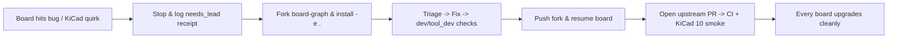

# board-graph

board-graph runs a circuit board project as a graph of cards, from inventory
through schematic, parts, footprints, placement, routing, checks, package,
order, assembly and first-board tests. Each card has a task, a pass condition
and the outcomes it allows; scripts check what they can, and the owner decides
what only the owner can. The position on the graph lives in one database on
the KiCad machine, and every move is also a JSON record committed to git. A
repository may hold several boards, each with its own cards and position.

## How board-graph self-heals (Fork and Evolve)

Most agent workflows hide failures behind one-off prompt hacks inside a
project repo, so the next project hits the exact same bug. `board-graph`
separates your **board repository** from the **engine repository** so every real
hardware failure upgrades the engine itself:



1. **Refuse silent workarounds:** When a card script or router hits a bug, the
   card stops and records `needs_lead` with the exact error receipt (`AGENTS.md`).
2. **Fork and install editable:** Clone your fork of `Arp-299-Org/board-graph`
   and install it with `pip install --no-build-isolation -e .` (and set
   `kicad_machine.tool_checkout` if driving a remote KiCad host).
3. **Walk the enforced 6-card self-healing board (`board-graph heal start <slug>`):**
   `board-graph next`, `record`, and `route` mechanically block PCB work if the
   tool checkout has uncommitted or unverified tool edits outside the 6-card
   workflow (`triage -> implement -> tool_checks -> cold_review -> live_smoke -> release`),
   and `board-graph hub` shows all 6 cards live. Inspect real KiCad files, IPC
   calls, or CLI output (`docs/KICAD_10_INVARIANTS.md`), add shared invariants plus
   contract tests, and walk all 6 cards cleanly.
4. **Resume your board, then upstream:** Once card 6 passes and unlocks the gate,
   resume the PCB cleanly and open an upstream PR back to `Arp-299-Org/board-graph`
   so GitHub Actions (Python 3.9/3.12 + Linux `Xvfb` KiCad 10 live IPC smoke)
   locks the fix in for every project.

Recent bugs from real boards that became permanent engine invariants:

| Failure observed | Root cause found in triage | Engine invariant added |
|---|---|---|
| Through-hole pads shorted solid to inner copper planes | `kipy.Zone()` wrote `0 mm` thermal spoke gap/width when left unset | `plan_pour()` defaults `0.5 mm` spokes + Linux Docker smoke check |
| Clean KiCad 10 first save broke approved placement diffs | KiCad 10 rewrote angles (`270` -> `-90`), `.0` floats, UUIDs, and setup blocks | Unified `canonicalize_guard_node()` across placement, copper, and reload checks |
| Unsupervised autonomous runs risking factory spend | Owner-gated cards blocked overnight delegation unless guarded at checkout | Explicit `autonomy: delegated` mode with immutable `order` hard ceiling |

## Two ways to use `board-graph`

| Mode | Install | Best for |
|---|---|---|
| **Pinned release** | `pip install git+https://github.com/Arp-299-Org/board-graph.git@v0.33.1` | Running a board on a stable tagged release (`board-graph init` scaffolds your project; upgrade only when you choose) |
| **Fork-and-Evolve (RSI-lite)** | Fork on GitHub, clone, and `pip install --no-build-isolation -e .` | Improving `board-graph` itself via `dev/tool_dev.py` whenever a board hits a snag, then opening an upstream PR ([CONTRIBUTING.md](CONTRIBUTING.md)) |

## What a project needs

| Need | Why |
|---|---|
| `board-graph` installed (`pip install git+https://github.com/Arp-299-Org/board-graph.git@v0.33.1`) on your PC, and a clone on the KiCad machine (`kicad_machine.tool_checkout`) if running over SSH | Runs the `board-graph` CLI against any board project without copying tool scripts into each repo |
| KiCad 10.0.x, at least the version `scripts/kicad_preflight.ps1` names | Editor work, ERC, DRC and fabrication exports |
| Python 3 (3.9 or newer on the KiCad machine, matching KiCad's Python) | Every script |
| PowerShell 7 (`pwsh`) | `kicad-run` and preflight checks |
| git and the GitHub CLI (`gh`), signed in | Records are committed and pushed; board branches get pull requests |
| An SSH key from the PC to the KiCad machine (when using a separate KiCad machine) | Reaches the state database and editor through `board-graph mac` |

Today you can run `board-graph` either **on one machine** (Linux + `Xvfb`,
Docker `docker/Dockerfile`, or a local macOS/Linux workstation) or across
**two machines** (for example a Windows PC where you and agents work plus a
Mac or Linux VM running KiCad over SSH). `Mode: ipc` routing, pours, DRC,
screenshots, and Gerber exports work on both macOS and Linux + `Xvfb`
(`.github/workflows/linux-kicad-smoke.yml`); `Mode: interactive` GUI shoving
(`kicad_route.py`) remains macOS-only.

## Whose files are whose

A board repository keeps only project files and starter files. The tool itself
lives in the installed `board-graph` package (plus `kicad_machine.tool_checkout`
on a remote KiCad machine).

| Files | Owner | Rule |
|---|---|---|
| Installed `board-graph` package (`board-graph` CLI) | the tool | Installed once per machine (`pip install git+...@v0.33.1`, or editable `-e .` when hacking on `board-graph` itself) |
| `tools/board_graph.json`, `board/board.json`, `tools/board_graph_site.json`, `tools/board_graph_records/`, `tools/board_graph_view/snapshot.js` (the page's copy of the graph, written by a full snapshot), `scripts/board_graph_project_actions.py` (optional), `tools/board_graph_pack.json` (optional: without it, the electronics pack), `tools/board_graph_boards.json` and each further board's files, the board's KiCad files, the docs under `board/` and `docs/`, `AGENTS.md`, `CLAUDE.md`, `.agents/`, `.claude/`, `.codex/`, `README.md` | the project | Created by `board-graph init` as a starting template; the project owns and edits them from then on |

Starter files written by `board-graph init` (never overwritten once present):

| File | What it is |
|---|---|
| `tools/board_graph.json` | The starter graph has 24 board cards in seven stages |
| `board/board.json` | The board description for a board called `example` |
| `tools/board_graph_site.json` | Machine settings with placeholder host and folders |
| `board/DECISIONS.md`, `docs/PRODUCT_TRUTH.md`, `board/SPACE.md`, `board/ELECTRICAL_AUDIT_CONTRACT.md` | Skeletons the project fills |
| `board/ORDER_PACKAGE_CONTRACT.md`, `docs/BOARD_ORDER_COMMON_SENSE_CHECKLIST.md` | The order gates G1 to G12 and the pre-order checklist |
| `docs/ROUTING_NOTES.md` | How routing is done with the tool, and a section for the project's findings |
| `.agents/skills/kicad-10-operator/` | The KiCad skill. `scripts/editor_step.py` reads its routing recipe |
| `.agents/critics.md`, `docs/BOARD_REVIEW.md`, `docs/SCHEMATIC_REVIEW.md` | Shared review criteria used by the provider wrappers |
| `AGENTS.md`, `CLAUDE.md` | Common agent instructions and the optional Claude entry point |

## Board description keys

Every path is relative to the repository root. `board-graph board-description` prints the description with absolute paths and refuses a missing key by name.

| Key | Holds |
|---|---|
| `name`, `project` | The board's name and the project's |
| `folder` | The board's folder |
| `schematic`, `pcb`, `kicad_project`, `rules`, `footprint_table` | The KiCad files; their stem is the KiCad project's name |
| `footprint_library` | The project footprint library (`.pretty`); its stem is the library's name in the footprint table |
| `model_folders` | Folders 3D models may come from |
| `bom_export`, `schematic_export` | The exported BOM (CSV) and schematic (PDF), remade with every schematic change |
| `owner_placement` | Position, rotation and side of each part the owner placed |
| `reports`, `production` | Card reports (`<reports>/<card>/`) and the order package |
| `drc_exclusions` | The accepted DRC list, which must be empty to order |
| `package_name` | A regular expression for the package's base name, matched before `_<date>` |
| `parts_data`, `datasheets` | `parts.json` (each MPN with its datasheet and height) and the datasheet folder |
| `decisions` | The decisions file |
| `electrical_audit` (optional) | `{"script": ..., "waivers": ..., "check": ...}`: the board's own electrical audit, or null |
| `board_audit` (optional) | `{"script": ..., "args": [...], "check": ...}`: the board's own full audit, or null |
| `hand_solder_notes` | `manual` (reference to note), `factory_parts`, `when_unpopulated`, `when_factory`, which the hand-solder list is written from |
| `part_models` (optional) | A Python file of the board's own 3D part models, which `scripts/kicad_step_model.py` writes as STEP files, or null |
| `manual_joints` (optional) | `{"names": {reference: what the part is}, "clearance_note": ...}` for the hand-soldered joints report, or null |
| `routing_agent` (optional) | `{"docs": [...], "recipe": ..., "recipe_skill": ..., "sensitive_nets": ...}`: what the routing agent and its reviewer are given by `scripts/editor_step.py`, or null |

## Quick start

### Fast path: single machine (macOS, Linux + Xvfb, or Docker)

1. Install `board-graph` (pinned tag or editable fork):
   ```sh
   pip install git+https://github.com/Arp-299-Org/board-graph.git@v0.33.1
   board-graph version
   ```
2. Create your board folder and initialize it (pass `--autonomous` for unattended test/benchmark runs through `quote_files`; `order` always requires `owner`):
   ```sh
   mkdir my-board && cd my-board
   git init -b main
   board-graph init
   ```
3. Set `tools/board_graph_site.json` to one-machine mode (state DB stored locally, no SSH needed):
   ```json
   {
     "one_machine": true,
     "state_database": "logs/board-graph/state.sqlite3"
   }
   ```
4. Edit `board/board.json` and `tools/board_graph.json` with your board name and paths, put your KiCad files under `board/`, fill `docs/PRODUCT_TRUTH.md` and `AGENTS.md`, then verify and start:
   ```sh
   board-graph board-description
   board-graph site-settings
   board-graph check
   board-graph where
   ```
   To run headlessly in Linux Docker with KiCad 10 + `Xvfb` preinstalled, build `docker/Dockerfile` (`docker build -t board-graph-linux -f docker/Dockerfile .`).

### Optional: two-machine setup (PC + remote Mac/Linux KiCad runner over SSH)

Follow steps 1 and 2 above, then:

1. Replace `example` paths in `board/board.json` and `tools/board_graph.json` with your board names, and verify with `board-graph board-description`.
2. Edit `tools/board_graph_site.json` with `kicad_machine` (SSH host, key, `tool_checkout` e.g. `"~/board-graph"`, checkout path, steps folder, worktree prefix, cache, disposable-copy prefix, and `editor_lock`). When using a remote checkout, `routing_run.py` automatically verifies or syncs the matching release/commit there before routing. Add `graph_page.python` if the page should run under another Python than `/usr/bin/python3`. Verify with `board-graph site-settings`.
3. Fill `docs/PRODUCT_TRUTH.md` and the product section of `AGENTS.md`, then run `board-graph check`, commit, and push. Use `--skip docs/PRODUCT_TRUTH.md board/DECISIONS.md` on `board-graph init` if your repo keeps those files under other names.
4. On the separate KiCad machine, clone your project repo and `board-graph` (matching tag), create the steps/state directories, and install the KiCad IPC environment:

   ```sh
   ssh -i <ssh_key> <ssh_host> "gh repo clone <owner>/<repo> <checkout>"
   ssh -i <ssh_key> <ssh_host> "git clone --branch v0.33.1 https://github.com/Arp-299-Org/board-graph.git ~/board-graph"
   ssh -i <ssh_key> <ssh_host> "mkdir -p <steps> <checkout>/logs/board-graph"
   ```

   Run `scripts/setup_kicad_ipc.ps1` inside `<tool_checkout>`, and on macOS allow SSH Screen Recording and Accessibility in System Settings so `board-graph mac look` works (on Linux, use `Xvfb` or `docker/Dockerfile`).
5. On the PC, run `board-graph where` and `board-graph next` to walk Inventory through first-board bring-up, `board-graph track-craft --output <path>` to run track-craft checks on the configured KiCad machine, `board-graph mac run "python3 <tool_checkout>/scripts/board_graph_serve.py --project <checkout> --install"` for the web graph page, and `board-graph run-checks` (or `board-graph mac run ...`) to record `Board checks` results.

## Several boards in one repository

A repository with one board needs nothing here. A project with a second board
lists its boards in `tools/board_graph_boards.json`:

```json
{
  "first": "strip",
  "boards": {
    "strip": "board/board.json",
    "driver": "driver/board.json"
  }
}
```

`boards` gives each board a name (lower-case letters, digits, `-` and `_`)
and its description. `first` names the board that keeps the files a one-board
repository has, so the board that was there first keeps its cards, its
records and its position. Every other board has files of its own:

| What | The first board | Another board, `<name>` |
|---|---|---|
| Cards and open issues | `tools/board_graph.json` | `tools/board_graph.<name>.json` |
| Records | `tools/board_graph_records/` | `tools/board_graph_records.<name>/` |
| State database on the KiCad machine | the site settings' `state_database` | beside it, `<name>/<the same file name>` |
| The page's data | `tools/board_graph_view/` | `tools/board_graph_view/boards/<name>/` |
| Reports, decisions file, footprint library, order package | from its description | from its description |

Two boards may name the same `parts_data` and `datasheets`. The KiCad machine
has one editor lock, so two boards are never edited at once.
`board-graph boards` prints each board and its files.

| Command | With no board named | With `--board <name>` |
|---|---|---|
| `board-graph where`, `board-graph check` | every board, one after the other | that board |
| `board-graph next`, `record`, `brief`, `settle`, `checks`, `graph` | refused, and the message names the boards | that board |
| `board-graph run-checks`, `board-graph route` | refused | that board |
| `board-graph view snapshot` | every board | that board |
| `validate`, `board-description` | the first board | `--board <name>` (or `--board-description` / `BOARD_GRAPH_BOARD`) |

`--board` goes before or after the command's name. What `next` and `brief`
print for a person to run names the board. The page shows one board's graph
at a time; a row at the top lists every board with where it stands, and a
row opens that board.

### Adding a second board

On a branch, in the project:

1. Make the board's folder, say `driver/`, with its KiCad project file, its
   schematic and its description `driver/board.json`: a copy of
   `board/board.json` with every name and path changed to the new board's.
   `parts_data` and `datasheets` may stay as they are. Run
   `board-graph board-description --board-description driver/board.json`
   until it prints the board.
2. Give the board the docs its cards will name: its own decisions file,
   space notes, electrical audit contract and order package contract
   (`driver/DECISIONS.md` and so on). The skeletons are in this repository at
   the tag:
   `git -C <checkout of this repository> show v<version>:board/DECISIONS.md`.
3. Write `tools/board_graph_boards.json` as above. `first` is the board that
   is already there, under the name the project gives it now.
4. Copy `tools/board_graph.json` to `tools/board_graph.<name>.json`. In the
   copy, change the first board's paths in the cards' `owns`, `docs` and
   tasks to the new board's, keep only the open issues that are this board's,
   and take out the cards that are not this board's work (a framework list
   belongs to one board's file).
5. Run `board-graph boards` and `board-graph check`, which checks every
   board's cards.
6. Where the project's own files tell an agent to run `where` and `next`
   (its `AGENTS.md`), say that a command names its board. A workflow that
   runs `board-graph checks` names it too.
7. Commit, open a pull request and merge it. The KiCad machine's main
   checkout must hold the list and the new cards before the new board's
   first command: `board-graph mac sync --apply`.
8. `board-graph where` now shows both boards, and
   `board-graph --board <name> next` runs Inventory for the new one.

Nothing of the first board moves: its cards file, its records and its
database stay where they are, and its position is what it was.

### A question that spans two boards

Each board has its own cards, and a card cannot wait on another board's
card. A question both boards depend on is held like this:

1. Write the question once, in a doc both boards read.
   `docs/PRODUCT_TRUTH.md` is read first on every card of every board. A
   project with more to say about how its boards join names a doc of its own
   in both cards files' `docs`.
2. Add an open issue to each board's cards file, with the same `id` and the
   same words. Its `close_before` names the first card on that board that
   cannot pass without the answer.
3. When the owner answers, write the answer beside the question in the
   owner's words, write each board's side of it in that board's decisions
   file, and take the issue out of both cards files in one pull request.

Until then `where` shows the issue on each card it blocks, on both boards,
and the card's brief prints it in full to whoever starts it.

## Revision-scoped approvals

The optional approval comparison explains which earlier reviews still apply to the saved design. Each board can observe the results and then enforce them. [Compare approvals and switch one board](docs/BOARD_APPROVALS.md).

## Cards that wait on each other

A card waits on another when it comes after it on its track, when it
`requires` it, or when an open issue blocks it and the other card is the one
whose work closes that issue. The graph cannot see the last kind unless the
issue says so: give an open issue `"closed_by": "<card>"` when one card's
work is what closes it. It is optional, and an issue without it adds no
order.

`python scripts/board_graph.py check` then refuses a loop, where no card in
it could ever pass, and names each card and why it waits. Only `check` says
so: `where`, `next` and `record` keep working on a graph that has a loop, so
taking a version never stops work that was running.

## Work on a branch, seen from main

Records made on a branch are not on main until its pull request merges, so
main's graph does not move for them. The page and `where --full` say where
each open pull request's branch stands by its own records: the cards it has
passed there and the card it stands at, marked as not merged. Nothing on
main changes for it.

## A graph that is not a circuit board

A project whose work is not a circuit board, on one machine such as a laptop,
takes the tool's files the same way (quick start, steps 1 and 2) and then
writes four files of its own:

| File | Holds |
|---|---|
| `tools/board_graph_pack.json` | `{"pack": "none", "reports": "reports", "branch_folders": []}`: no electronics, the folder the cards' reports go in, and any folders whose changes go on a branch and a pull request |
| `tools/board_graph_site.json` | `{"one_machine": true, "state_database": "logs/graph/state.sqlite3"}`: the position is kept in that file in the repository's main checkout, made by the first command that writes. Keep its folder out of git (`logs/` in `.gitignore`) |
| `tools/board_graph.json` | The graph: its tracks and cards. With no track named `board`, the page draws the track whose cards name a stage, else the first track with cards |
| `scripts/board_graph_project_actions.py` | Optional: the project's own card scripts |

Several graphs in one project, one per goal, are listed as several boards
are (below, Several boards in one repository): `tools/board_graph_boards.json`
gives each graph a name and a small file of its own, such as
`graphs/essay.json` holding `{"name": "essay", "project": "Writing"}`, whose
`project` the page's title shows. Each graph has its own cards, records,
position and page, a command names its graph with `--board <name>`, and the
page lists them all, each by its `name` and where it stands. Each graph
keeps its own reports: the first graph in the pack's `reports` folder,
another in `<reports>.<its name>`, or wherever `{name}` in `reports` puts
them (`"reports": "reports/{name}"`). The project's card scripts are one file
for every graph: a function that takes a second parameter called `graph` is
given the graph's name, and `{name}` in a path it reads stands for that name.

Four things help when the same cards are walked again and again, once for
each piece of work:

- **Notes on the page.** The pack file may name one notes file per graph,
  `"notes": "notes/{name}.md"`, where `{name}` is the graph's name in the
  list. A card's panel on the page shows its part of that file: the part
  under the `## ` heading that names the card (its label, with or without
  "the"), and nothing else, so keep there the few lines that stand now, not
  the talk that led to them. A served page
  shows what is written within a few seconds, with no record needed.

- **Stages on any track.** In a graph with no track named `board`, the cards
  of one track may each name a `stage` from the graph's `stages`. `where`
  and the page then group that track's cards by stage, and `next` steps that
  track when no `--track` is given.
- **Dropped.** A graph whose `move_outcomes` also name `"dropped": "end"`
  may give a card `"dropped": true` in its `outcomes`. At such a card the
  owner, and nobody else, records
  `record <card> dropped --by owner --note "<why>"`, with no evidence: the
  track ends there, and `where` and the page say it was dropped, at which
  card and why. Use it where giving the work up is an ordinary ending.
- **A new graph with the same cards.**
  `python3 scripts/boards.py new <name> --title "<words>"` lists a graph
  called `<name>` with a copy of the first graph's cards (`--like <name>`
  copies another's) and a position, records and page of its own. Commit the
  files it writes before the first `next`. `{name}` in a path a card owns or
  a doc it names stands for the graph's name, so the copy's cards name the
  new graph's files; a path without it names the same file in every copy,
  and `new` lists those.

`AGENTS.md` must exist, as `check` requires. Then
`python3 scripts/board_graph.py check`, `where`, `next --track <track> --by
<who>` and `record` work as for a board, and
`python3 scripts/board_graph_serve.py --bind 127.0.0.1` serves the page at
http://127.0.0.1:8000 while it runs. `scripts/test_graph_pack.py` walks such
a project.

## Upgrading to a new version

Releases are tagged `v<version>` (`0.MINOR.PATCH`). Nobody gets a breaking
change automatically: projects stay on the release tag you installed until you
choose to upgrade:

```sh
pip install --upgrade git+https://github.com/Arp-299-Org/board-graph.git@v<version>
```

Before bumping a minor version (`0.33.x` -> `0.34.0`), read `UPGRADING.md` (or
`git tag -n99 v<version>`) to see if any project-owned files or task headers
need updates, and run `board-graph init` in your project if you want any newly
added starter files (existing files are never overwritten).

If you installed editable from a local git clone (`pip install -e .`),
`git pull` updates your PC immediately and `kicad_machine.tool_checkout` syncs
your KiCad machine to the matching commit SHA automatically.

## The tool's tests

Every `test_*.py` the manifest lists is the tool's. Run them in this
repository after checking hygiene and the manifest (`python3` instead of
`py -3` on macOS/Linux):

```sh
py -3 .github/scripts/check_hygiene.py
py -3 scripts/board_graph_tool.py check
py -3 dev/test_tool_dev.py
for t in $(py -3 -c "import json; print(' '.join(f for f in json.load(open('tools/board_graph_tool.json'))['files'] if f.rsplit('/', 1)[-1].startswith('test_') and f.endswith('.py')))"); do py -3 "$t" || echo "FAILED $t"; done
```

The unit and workflow suites need no SSH, no macOS host, and no local KiCad
install. Their fixtures live under `scripts/fixtures/` (generic `DemoBoard`
graph, board description, machine settings, launchd plist, and frozen routing
receipts), while `scripts/test_boards.py` builds a two-board repository in a
temporary directory. Cases that drive real KiCad binaries skip unless
`BOARD_GRAPH_TEST_KICAD=1` is set (`tools/kicad/test_kicad_semantic_snapshot.py`
requires Python 3.10 or newer). GitHub Actions (`.github/workflows/test.yml` and
`.github/workflows/linux-kicad-smoke.yml`) runs hygiene, manifest checks, wheel
install smoke, Python 3.9/3.12 test suites, and a headless KiCad 10 + `Xvfb`
live IPC Docker smoke on pull requests and pushes.

## Current boundaries

- **Work that is not a circuit board.** The engine reads card scripts, views,
  and folders from a pack (`pack: none` runs non-board workflows on a single
  machine). A few UI labels and multi-graph list names still default to `board`
  terminology.
- **Two machines vs single-machine mode.** Single-machine workflows work on one
  host (`"one_machine": true`), and `Mode: ipc` routing, pours, DRC, renders,
  and Gerber exports run on Linux + `Xvfb` as well as macOS and Windows.
  `Mode: interactive` GUI shoving (`scripts/kicad_route.py`) and `launchd` graph
  page installation remain macOS-only. `scripts/editor_step.py` supports Codex,
  Gemini (`agy`), and Claude providers.
- **Routing model choice.** `board-graph` allows any model supported by Claude,
  Codex, or Gemini (`agy`). Note that in earlier routing trials, Claude Opus
  models repeatedly tried to bypass the live KiCad editor (writing offline
  scripts or pitching autorouters instead of driving the locked editor), so
  watch Opus routing runs closely or prefer another model.
- **Cross-board coordination.** Each board keeps its own cards, records, and
  position; shared constraints across boards are tracked via open issues rather
  than cross-board `requires` edges.
- **Standalone CI.** Board repositories can attach their own validate workflow
  or run `python3 scripts/run_board_checks.py` locally and record results with
  `scripts/board_graph.py checks`.
- **Fabrication format defaults.** Built-in packaging scripts emit JLCPCB BOM
  and mirrored back-side CPL conventions (`180 - KiCad angle`) and check `LCSC Part #`
  consistency; other assemblers can override packaging scripts via `board/board.json`.
